# About GeoUltra

GeoUltra is a GEOS-compatible system for the Commodore 64 with an
Ultimate. It starts from a cartridge file on the Ultimate, keeps its
drives as disk images in the REU, and stores everything on the
Ultimate's USB stick or SD card: disk images, settings, printouts.
It comes with its own desktop (a file manager for the GEOS drives and
the Ultimate's file system), a settings program, a shell (gush), its
own fonts and printer drivers, and a writer that turns geoWrite
documents into PostScript.

GeoUltra aims to run existing GEOS applications: it keeps the GEOS 2.0
programming interface where GEOS 2.0 put it, and its routines are
checked against GEOS 2.0's behaviour. It does **not** promise that
every GEOS application runs. The GEOS world has many versions, add-ons
and later developments, some of them lost, and programs that rely on
undocumented details may fail. The same goes for hardware: peripherals
are supported on a best-effort basis. "What was tested" at the end of
this manual lists what was tried.

GeoUltra contains no Berkeley Softworks code and ships no GEOS
software. Your GEOS applications, fonts and documents are your own
copies, used from disk images.

This is a **beta**: it works for daily use in the tests so far, but
expect rough edges. Back up your disk images before you start (GeoUltra
also keeps a copy of each image before it first writes to it; see
"Disk images and drives").

For a PC there is a second manual, **GeoUltra PC tools**
(docs/manuals/TOOLS_MANUAL.md): programs that make and fill GEOS disk
images, convert geoWrite documents to and from Word, Markdown and
PostScript, turn geoPaint pictures into PNG and back, and make GEOS
fonts.

# Getting started

## What you need

- An **Ultimate 64**, **Ultimate 64 Elite** or **Commodore 64
  Ultimate**, firmware **3.15** or later. (The Ultimate II+ and the
  C128 versions are planned.)
- The Ultimate's **REU** set to **16 MB** and its **Command
  Interface** enabled. The configuration file that comes with
  GeoUltra sets both (below).
- A **USB stick** (or the SD card) for GeoUltra's home folder and your
  disk images.
- A **mouse**: a 1351 (or compatible) in port 1, or a USB mouse on the
  Ultimate 64.
- Your own GEOS applications as disk images (D64, D71, D81 or DNP).
  GeoUltra's desktop, settings, shell, fonts and printer drivers are
  built in; applications such as geoWrite and geoPaint are not.

## Installing

1. Copy `geoultra64.crt` and `geoultra64.cfg` into one folder on the
   stick or the SD card, for example `/USB0/GEOULTRA/`. Keep both
   names: the Ultimate finds the `.cfg` by the `.crt`'s name.
2. Copy your GEOS disk images onto the stick.

That is all. At the first start GeoUltra makes its home folder
`GEOULTRA` on the first of `/USB0`, `/USB1` and `/SD` it finds, with
an empty list of disk images to mount.

## Starting

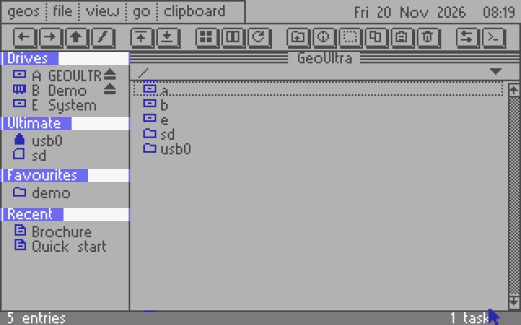

*The desktop after the start: the drives, the Ultimate's roots, a favourite and the recent documents in the sidebar.*

In the Ultimate's file browser, select `geoultra64.crt` and run it. The
firmware then loads `geoultra64.cfg` with it: REU 16 MB, the Command
Interface, the turbo registers, the printer emulation (Epson FX-80 on
device 4). These settings apply to this session only; your saved
Ultimate settings stay as they were.

You can also make GeoUltra the Ultimate's start-up cartridge. The
`.cfg` is not loaded then, so set the REU to 16 MB and enable the
Command Interface in the Ultimate's own menu and save them. Without an
REU the start screen says "No REU found: enable the REU (16 MB)".

The start shows a splash picture while the system is copied into the
REU, then the desktop. Keys held while it starts:

- **SHIFT**: the auto-exec programs are not run (see "Settings",
  Start page).
- **C=**: a hibernated session is not resumed; GeoUltra starts fresh.

## Your first disk images

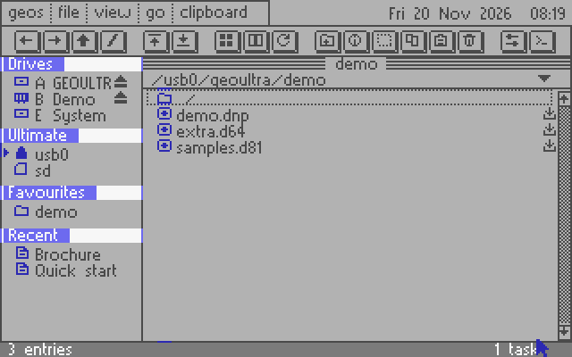

*A folder on the Ultimate: disk images with the mount icon at the right end of their lines.*

The desktop's sidebar lists the drives A-E and the Ultimate's own
roots (usb0, usb1, sd). To put a disk image on a drive:

1. Click **usb0** (or wherever your images are) in the sidebar and
   find the image.
2. Click the **mount icon** at the right end of its line (a thin arrow
   into an open tray), or choose **mount** in its context menu (the
   right mouse button).
3. Choose the drive (A-D).

GeoUltra remembers the images in `GEOULTRA/MOUNTS.INI` and mounts them
again at every start. To start geoWrite, open the drive with your
geoWrite disk and double-click geoWrite (or a document of it).

## Serial numbers of your applications

Berkeley's applications are keyed to the serial number of the GEOS
boot disk they were installed with. When one of your GEOS 2.0 boot disk
images (with `GEOBOOT` on it) is mounted at the start, GeoUltra uses
its serial number, so applications installed under that GEOS run. If
an application refuses ("Please reboot your system using the same GEOS
disk..."), see "Serial numbers".

## Hibernation and switching off

GeoUltra writes changed disk images back to the stick by itself, a few
seconds after a program writes. When the system has been idle for a
while (set on Settings' System page), it **hibernates**: it saves the
whole session (every task, the screen, the drives) to the stick. After
a power cycle it comes back where you were. Hold **C=** while it starts
to begin fresh instead.

Before switching off, wait until the drive activity has stopped (a
write-back takes a few seconds); with hibernation on, wait until the
session has been saved.

# The desktop

GeoUltra's desktop is what you see after the start: a file manager for
the GEOS drives and the Ultimate's file system, and the place programs
are started from. GeoUltra always starts its own desktop (or gush, see
"gush, the shell"); GEOS 2.0's deskTop from a mounted boot disk starts
only when GeoUltra's cannot.

## The screen

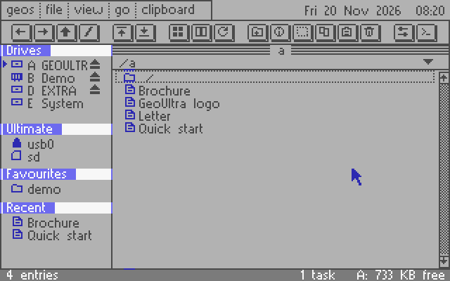

*The desktop's list view of drive A.*

From top to bottom:

- **The menu bar**: the menus geos (GeoUltra info, settings, gush, the
  print queue and the desk accessories), file, view, go and clipboard on
  the left, the date and time on the right (unless the theme or the
  clock setting leaves them out). Everything the toolbar does is in the
  menus too. GeoUltra info shows the version with the build's time
  stamp (v0.9.0-20261120-1310: version 0.9.0, built 20 November 2026
  at 13:10); its "splash" button shows the start picture again. Drive
  E's desk accessories (geoFolder) come first in the geos menu, in
  every application's too.
- **The toolbar**: buttons for the things done most (see "The
  toolbar").
- **The sidebar** on the left: the drives, the Ultimate's roots, your
  favourite folders and your recent documents.
- **The list** on the right: the title bar with the current folder's
  name, the path line, and the folder's entries; a scroll strip on the
  right edge.
- **The status line** at the bottom: how many entries there are, how
  many are selected, the free space on the drive, and the number of
  tasks.

## Moving around

- **Mouse**: a click on an entry selects it (the others no longer); C=
  and a click adds it or takes it away again; SHIFT and a click selects
  everything from the cursor to it. A double click opens the entry.
- **Keys**: cursor up and down move the cursor (C= held: the selection
  grows with it), HOME goes to the first entry, RETURN opens the entry
  under the cursor, cursor left goes up a folder; C= and cursor left or
  right go back or forward through the folders visited.
- **The go menu**: back, forward, up, root (all drives), home
  (GeoUltra's folder on the Ultimate), system fonts, top and end.
- **Sidebar**: a click on a drive or an Ultimate root goes there; a
  click on a favourite goes to that folder; a click on a recent
  document opens it.
- **Path line**: a click on a part of the path goes to that folder.
- **Scroll strip**: the arrows move the list a row (in the icon view a
  row of icons), a click above or below the thumb a page.

Opening an entry:

- a **folder** or **drive**: goes into it;
- a GEOS **application** or **desk accessory**: starts it; a
  **document** starts the application it belongs to with it (see
  "Programs and documents");
- a **printer driver**: makes it the printer;
- a **disk image** on the Ultimate (`.d64`, `.d71`, `.d81`, `.dnp`):
  goes into it like a folder (see "Disk images and drives");
- any **other file on the Ultimate**: is not opened (see "Drives:
  what works where").

## Views and sorting

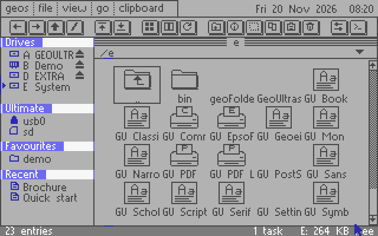

*The icon view (drive E, the system drive).*

view > view chooses how the list shows the entries (the toolbar's view
button goes through them in turn):

- **list**: a small icon and the name, one entry a row;
- **icons**: a grid of large icons with the name under each. GEOS files
  show their own icon; folders, drives, plain files and disk images
  show GeoUltra's own. Icons can be coloured by type (see "Themes");
- **detailed**: the list with the size and the date (GEOS files) beside
  each name.

The list is sorted: ".." (the folder above) first, then folders and
drives, then files, each group in the chosen order; upper and lower
case count the same. There are three orders: by **name** (A to Z, the
default), by **date** (newest first) and by **size** (largest first),
each also reversed.

- In the detailed view, the **Size** and **Date** headings on the path
  line are buttons. Each click takes one step: sorted by that column,
  then reversed, then back to names. The heading the list is sorted by
  is **bold**; when neither is bold, the list is sorted by name.
- The small **arrow** at the right end of the path line turns the
  current order round in every view (pointing up: reversed). Folders
  and ".." stay first.
- Settings' Desktop page chooses the order too.

Folders with more than 384 entries keep the order they have on disk.

## Two panes

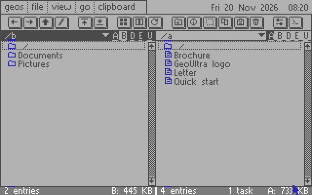

*Two panes: drive B on the left, drive A on the right.*

view > two panes (C=P, or the toolbar's button between view and
refresh) shows two folders side by side, the sidebar hidden. Each pane
has its own folder, list, selection, scroll strip and half of the
status line; the active pane's path line is inverted, and the menus,
keys and toolbar act on it. A click in a pane, or C=SPACE, makes it the
active one.

Each path line ends in the drive letters (the drives with an image, and
E), the pane's own drive marked; a click on one opens that drive; U
lists the Ultimate's roots. A click on the path text opens a list of
all places: the drives, the Ultimate's roots and your favourites. The
panes show the list or the icon view. The same keys and menu switch
back to one list.

Copying between the panes: **copy to other** (C=T) and **move to
other** (C=M) in the file menu and the context menu put the selection
into the other pane's folder; or copy (or cut) in one pane and paste in
the other.

## Drag and drop

Press on a selected entry and move the mouse with the button held: the
selection is dragged (its icon follows the pointer).

- Released over **the other pane**: it goes into that pane's folder.
- Released over **a folder** in the same list (not part of the
  selection): it is moved into that folder. While you drag, the folder
  or sidebar line it would go into is shown inverted.
- Released over **a drive or a favourite** in the sidebar: it goes
  into that drive's top folder or that favourite folder.

On the same drive the entries are moved, to another drive copied. Hold
**C=** while releasing to copy instead of move (or move instead of
copy). Folders are taken with everything in them.

## Files and folders

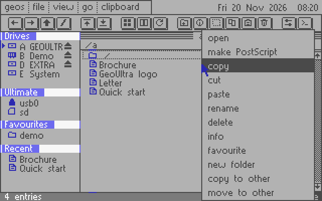

*The context menu of a geoWrite document.*

All in the file menu, with their keys:

| Action | Key | |
| --- | --- | --- |
| open | C=O | as a double click |
| open in new task | C=W | opens the entry in a new task (see "Tasks") |
| info | C=I | name, kind, size, date and GEOS class |
| copy | C=C | the selected entries (or the one under the cursor) onto the clipboard |
| cut | C=X | the same, to be moved |
| paste | C=V | copies (or moves) them into the current folder; asks before replacing a file (Yes, Yes to all, No) |
| delete | DEL | asks first; a folder with things in it asks once more |
| rename | C=R | |
| new folder | C=N | on drives with folders (native drives, 1581 partitions, the Ultimate) |
| select all | C=A | every entry but ".." |
| favourite | C=F | the current (or selected) folder into the sidebar's favourites (up to 4; the oldest goes) |

Folders are copied, moved and deleted with everything in them. A long
copy shows its progress on the status line; RUN/STOP stops it.

**The right mouse button** opens a context menu at the pointer with
open, copy, cut, paste, rename, delete, info, favourite and new folder.
Over an entry that is not selected yet, it selects that entry first. A
click outside the menu, RUN/STOP, ESC or the right button again closes
it. (On a 1351 the right button is the one GEOS programs do not use;
the Ultimate 64's USB mouse works as one.) Some entries get an item of
their own as the menu's first or second item: **mount** on a disk
image, **use as printer** on a printer driver, **make PostScript** on a
geoWrite document, **install as system font** on a font.

## The toolbar

Under the menu bar, in five groups:

| Buttons | |
| --- | --- |
| back, forward, up, root | the folders visited before and after (the last 16), the folder above, `/` (all drives) |
| top, end | the first and the last entry |
| view, two panes, refresh | the next view; one list or two panes; the folder read again |
| new folder, info, select all, copy, paste, delete | as in the file menu |
| settings, gush | GeoUltra Settings, GeoUltra's shell |

view > toolbar sets its height: **two lines** (framed buttons, the
default), **one line** (the icons alone) or **off**.

## Clipboard

GEOS programs keep what you cut or copy in scrap files ("Text  Scrap",
"Photo Scrap"). GeoUltra keeps them in one place for all drives and
tasks, so you can copy in a program on one drive and paste in another
program on another drive. The clipboard menu:

- **show**: the text's size and first characters, the picture's size
  and the picture itself (when it is not too large), and how many other
  scraps there are;
- **save as file**: each scrap saved as a file in the folder shown (on
  drive A-D), under a name you give;
- **clear**: after asking, the clipboard emptied.

# Disk images and drives

## Drives A to E

Drives A to D hold disk images from the Ultimate. While mounted, an
image is kept whole in the REU, and changes are written back to the
image file a few seconds after a program writes (and before a program
or GeoUltra ends). Before the first write after mounting, GeoUltra
keeps a copy of the image in `GEOULTRA/BACKUP/`.

Drive E is GeoUltra's system drive inside the cartridge: the desktop,
Settings, gush, GU PostScript, geoFolder, the GU fonts and printer
drivers. It cannot be written to.

## Mounting and unmounting

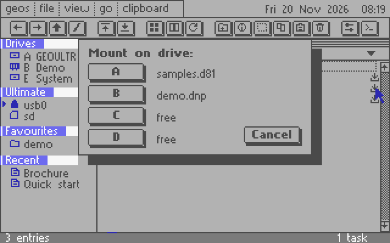

*Mounting an image: the drive asked.*

- **Mount**: the mount icon at the right end of an image's line, or
  **mount** in its context menu; then choose the drive.
- **Unmount**: the eject icon on a drive's line in the sidebar (after
  writing it back).
- **Settings' Drives page** does the same and more (see "Settings").
- At the start, the images in `GEOULTRA/MOUNTS.INI` are mounted
  (`A=/USB0/GEOS/apps.d81`, one line per drive). Mounting and
  unmounting keep this file up to date.

## Going into an image without mounting it

Opening (double click, RETURN) an image on the Ultimate goes into it
like a folder, without mounting it: its files are listed, and they can
be copied in and out, renamed and deleted; changes are written to the
image file straight away. `..` leaves it again. It needs:

- an **empty drive letter** (A-D), which the image borrows for a moment
  for each step;
- **room in the REU** for the whole image (a D81 13 banks of 64 KB, a
  DNP one per track), beside the mounted drives;
- the image **not mounted**: a mounted one is opened through its drive.

A document inside an image that is not mounted cannot be opened from
there: the desktop asks "Not mounted. Mount it?"; Yes shows the drive
dialogue, and after mounting the document opens from that drive. The
same question comes for a document in the Recent list whose image has
been unmounted since. Programs inside an image are started after
mounting it.

## Drives: what works where

| Kind of drive | What it is | Programs and documents | Folders | Writing |
| --- | --- | --- | --- | --- |
| A-D: D64, D71 | a 1541 or 1571 disk image | start and open | no | yes |
| A-D: D81 | a 1581 disk image | start and open | 1581 partitions act as folders | yes |
| A-D: DNP | a native (CMD) disk image (up to 16 MB as a format; the REU holds about 10 MB for all mounted drives together) | start and open | yes, nested | yes |
| E | GeoUltra's system drive in the cartridge | start | yes | no |
| usb0, usb1, sd | the Ultimate's own file system | **not** started or opened | yes | yes |

In practice:

- **GEOS programs and documents only work on drives A-E.** On the
  Ultimate's file system a GEOS file is kept in CVT form (one file
  holding the whole GEOS file); opening it there shows "Not opened
  here". Copy it to one of the drives A-D first.
- **Copying between them converts.** A GEOS file copied onto the
  Ultimate becomes `name.cvt`; a `.cvt` copied onto a GEOS drive becomes
  the GEOS file again. Plain CBM files get `.prg`, `.seq` or `.usr` on
  the Ultimate and lose it again on the way back.
- **Sizes**: the Ultimate's listings give no sizes, so the detailed
  view leaves them empty for files there; Info shows a file's size.
- **Real disk drives** on the serial bus are not supported yet.

# Programs and documents

## Opening documents

A double click on a document starts the program it was made with, with
the document open. When several versions of that program are found,
the **newest** is started (geoWrite 2.1 rather than geoWrite 1.x on an
old work disk; geoWrite 2.1 then offers to convert an older document).
The desktop looks in the document's folder, then on each drive A-D in
its root folder and the folders directly below it.

Some programs, geoWrite 2.1 among them, only find a document they are
started with on drive A or B. For a document on C or D, the desktop
therefore swaps drive B and the document's drive while the program
runs and swaps them back when the program ends.

## Tasks

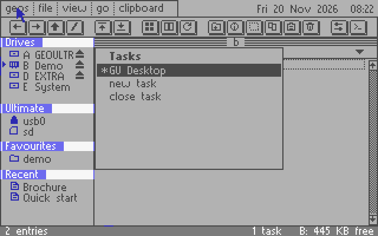

*The task list (C= + RUN/STOP).*

GeoUltra can keep several programs running, each in its own task, and
switch between them.

- **C= + RUN/STOP**, in the desktop or in any application, opens the
  task list: each running task (the current one with a "*"), **new
  task** (the current one is kept as it is and a fresh desktop starts)
  and **close task** (the current one ends; the last one stays).
  Cursor keys and RETURN, or a click, choose; RUN/STOP or a click
  outside closes the list.
- The status line shows the number of tasks at its right end; a click
  there opens the same list.
- **open in new task** (C=W) opens the entry under the cursor in a new
  task, while this one waits as it is.

Each task keeps its own memory in the REU, and hibernation keeps them
all. A document open in one task is saved when you leave that task and
cannot be opened, deleted, renamed or moved in another task until it is
closed ("It is open in another task."). The number of task slots is
set on Settings' REU page.

## Desk accessories

Desk accessories (geoDex, Calculator, ...) on the current drive and on
drive E appear in the geos menu of the desktop and of every
application. **geoFolder**, on drive E, is GeoUltra's own: a small file
box from inside any application, with a button for gush.

# Settings

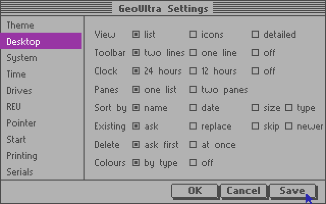

*GeoUltra Settings, the Desktop page.*

**GeoUltra Settings** (geos > settings, or the toolbar's settings
button) changes GeoUltra's settings without editing files: a list of
pages on the left, the page on the right, and three buttons: **OK**
(save and leave), **Cancel** (leave; it asks when something was
changed) and **Save** (save and stay). Most settings take effect when
the desktop starts again (after OK); those read at the cold start say
so on their page.

| Page | What it sets |
| ------- | ------------------------------- |
| **Desktop** | the view, toolbar, clock and two panes; the sort order (name, date, size, type); what happens when a copied file is already there (ask, replace, skip, or replace only an older one); whether deleting asks first; icon colours by type |
| **Theme** | edits the themes (see "Themes"): choose one with - and +, "use" makes it the desktop's, "copy" starts a new one from it; each part of the screen's style, ink and paper, with a preview; on the Ultimate 64 the palette (the 16 colours themselves) |
| **System** | the turbo (full speed, off, or a step chosen with - and +, shown in MHz; it changes at once); the programs that must run at 1 MHz (add, remove); how long the system waits without input before it hibernates (off, 15 s, 30 s, 1 min, 5 min) |
| **Time** | the time server (click the box to type it); "now" sets the clock from it; the time zone in quarter hours; summer time by the EU's rule or off; the date and time by hand. The server also sets the clock at every start |
| **Drives** | drives A-D with their images: "choose" browses the Ultimate for an image and mounts it, "none" unmounts it; long names on or off per drive; a DNP's size with "resize"; "new image" makes an empty D64, D71, D81 or DNP |
| **REU** | how the 16 MB are used (a cell per 64 KB: the system, each drive, the tasks, free); the REU older applications see (512 KB to 4 MB per task) and the number of task slots; the print queue's size. Taken at the next start |
| **Pointer** | the mouse pointer: a classic arrow, a large arrow, a hand or a crosshair, and its colour |
| **Start** | the auto-exec programs the cold start runs before the desktop, in order (add from the drives, remove, up, down). Holding SHIFT at power-on skips them |
| **Printing** | the printer (see "Printing"); the serial bus timing (standard, fast); the fonts in programs' lists (all, or system only); GU PostScript's paper and look |
| **Serials** | the serial number GeoUltra gives and the serials per application (see "Serial numbers") |

Everything is kept in `GEOULTRA/SETTINGS.INI` on the stick, a plain
text file you can also edit on a PC ("Files on the stick" lists the
keys).

## Themes

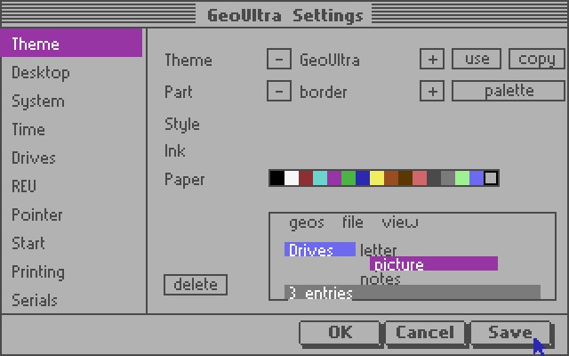

*The Theme page: a theme, its parts and colours, with a preview.*

view > theme chooses the look: **GeoUltra** (the default), **GEOS
classic**, **Flat**, **Detailed**, **Night**, **Mono**, and **Custom**
(to edit). Each is a text file in `GEOULTRA/THEMES` on the stick, one
line per part of the screen, in words, for example:

```
[theme]
name=Custom
border=light grey
desk=dark grey on light grey
menubar=clock, dark grey on light grey
sidebar=wide, dark grey on light grey
headings=inverted, white on light blue
titlebar=stripes, dark grey on light grey
rows=9
columns=name
icons=on, blue
selection=invert, white on blue
cursor=dotted, blue
scrollbar=arrows
status=on, white on grey
toolbar=dark grey on light grey
```

"X on Y" is X text on a Y background. The styles each part takes:
menubar plain or clock; sidebar wide or narrow; headings inverted, band,
underlined or plain; titlebar stripes, solid, line or none; rows 9 or 8;
columns name or detailed; icons on or off; selection invert, bar or
frame; cursor dotted, mark or underline; scrollbar arrows or thin;
status on or off. A file needs only the lines it changes. On an
Ultimate 64 a theme may also set the 16 colours: `palette=` and 16
RRGGBB values (black ... light grey), as in the Night theme's file.
The desktop's menus and dialogues take the menu bar's colours; programs
and desk accessories keep GEOS's own.

Icons coloured by type: a theme's `icons-apps=`, `icons-documents=`,
`icons-accessories=`, `icons-system=` (fonts, drivers, boot files),
`icons-folders=` (folders and drives) and `icons-ultimate=` lines each
give a colour; a type without a line keeps the desk's colour.
`icons-bytype=off` switches them off for the theme, `iconcolours=off`
in `SETTINGS.INI` (Desktop page) for every theme.

# Printing

## Choosing a printer

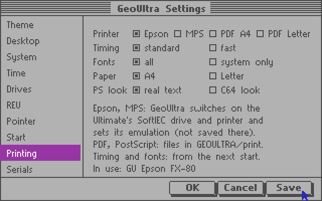

*The Printing page.*

GeoUltra has four printer drivers of its own on drive E:

| Driver | Prints to |
| ------- | ------------------------------- |
| **GU Epson FX-80** (the default) | the Ultimate's printer emulation in Epson FX-80 mode, or a real Epson-compatible printer on the serial bus; the Ultimate saves the pages as PNG pictures |
| **GU Commodore MPS** | the emulation in Commodore MPS mode, or a real MPS printer |
| **GU PDF A4**, **GU PDF Letter** | a PDF file on the stick: `GEOULTRA/print/<program>-YYYYMMDD-HHMMSS.pdf`, one page picture per page |

Choose the printer on Settings' Printing page, or open (double-click) a
printer driver in the desktop, also one of your own GEOS printer
drivers: it is then the printer for every program ("`<name>` is the
printer now"). Programs find the driver on their own drive or on drive
E. For the first two, the Ultimate's printer emulation must be set to
the same mode (the Ultimate's menu, Printer settings; `geoultra64.cfg`
sets Epson FX-80 on device 4).

The **timing** row on the Printing page: **fast** sends to the printer
faster than the serial bus standard allows. The Ultimate's emulation
takes it (a fully black page in 210 s instead of 261 s); a real printer
may not, so leave it on standard for one.

## The print queue

Programs print into a queue in the REU and can go on at once; the
queue sends the pages to the printer in the background. The menu bar
shows "printing 2/5, 45%" (job 2 of 5, 45% printed) or "print paused".
A click on it, or geos > print queue, opens the queue window: a line
per job with its cancel button, the program, its pages and its state,
and pause or resume. The queue survives hibernation; its size is set on
the REU page.

## PostScript

**GU PostScript** (drive E) turns a geoWrite 2.x document into a
PostScript file, `GEOULTRA/print/<document>.ps`, laid out as geoWrite
lays it out. A PC makes a PDF of it (`ps2pdf`), any PostScript printer
prints it.

- In the desktop, the context menu of a geoWrite document has **make
  PostScript**. Or start GU PostScript on its own and choose a
  document in its file box. In gush: `"/e/GU PostScript" "/b/letter"`.
- A box asks for the **paper** (A4 or Letter) and the **look**:
  **Real** (the LaserWriter and GU fonts become the printer's own fonts:
  sharp at any size, the text searchable in a PDF) or **C64** (every font
  from its bitmaps, exactly as on a C64 printer). It starts with
  Settings' choice (Printing page). **OK** writes the file.
- It handles any bitmap font, bold, underline, reverse and outline,
  tab stops, all alignments and line spacings, pictures, header and
  footer. An 11-page document with pictures takes about a minute.

If you have **geoLaser** or **geoPubLaser** (Berkeley's PostScript
programs), the file they write onto drive A or B (`PS.<name>`) is picked
up when the desktop starts: it is moved to `GEOULTRA/print/<name>.ps` on
the stick and deleted from the disk image, and a note says so.

# Fonts

## GeoUltra's fonts

Drive E holds GeoUltra's own fonts in ten families (GU Serif, GU Sans,
and others), drawn from free fonts (TeX Gyre and the X Window System's
bitmap fonts). They are in every program's font list. Several follow
the LaserWriter fonts' metrics, so GU PostScript prints them as real
PostScript fonts.

## System fonts

Fonts you want in every program, whatever the disk, go into
`GEOULTRA/FONTS.DNP` on the stick: a disk image of its own (512 KB,
room for about 100 fonts), loaded at every start. Programs list them
with the fonts of the current disk and drive E's GU fonts, and find
them when a document uses them.

- **Installing from the desktop:** the context menu of a font file (a
  GEOS font on any drive) has **install as system font**; a font in
  "installed fonts" (go > system fonts) has **uninstall**. GeoUltra
  needs a free drive letter for a moment; with A-D all in use it says
  so. The change counts from the next start: answer **Yes** to "Restart
  now?" and GeoUltra restarts and comes back where you were.
- **CVT files dropped into `GEOULTRA/fonts`** (its top, not its
  subfolders) are installed by the desktop when it starts.
- **The same font ID twice:** an installed font wins over a disk's font
  with the same ID, and a disk's font wins over the GU fonts. A
  program's list shows each ID once.
- **Only the system fonts:** Settings' Printing page, "Fonts: system
  only", leaves the disks' fonts out of the lists. A document that uses
  a font only its own disk has then shows the program's substitute.
- **Filling it on a PC:** with geosdisk (docs/manuals/TOOLS_MANUAL.md).

# Serial numbers

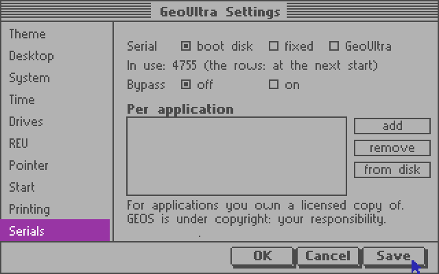

*The Serials page.*

GEOS applications from Berkeley Softworks key themselves to the serial
number of the GEOS boot disk they were installed under, and refuse to
run under another one. GeoUltra gives each application a serial
number, chosen on Settings' **Serials** page:

- **Serial**: **boot disk** (the default: the serial of your own GEOS
  2.0 boot disk, read from `GEOBOOT` on a mounted drive at the start),
  **fixed** (a number you type, four hex digits) or **GeoUltra**
  (GeoUltra's own number, 4755). "In use" shows the number given now.
- **Per application**: a list of applications with a serial of their
  own (by class, the application's name in its file: `geoWrite`). Use
  it when your applications were installed under different boot disks.
  **add** asks the class and the number; **remove** takes the selected
  line out; **from disk** reads the serial of a GEOS boot disk on drives
  A-D and asks which application it is for. Changes count at once.

When an application refuses ("Please reboot your system using the same
GEOS disk..."), the desktop asks after it has ended: "geoWrite refused
to run (its serial). Set it in Settings?". **Yes** opens the Serials
page and asks the number for that application: the serial of the boot
disk it was installed with. GeoUltra recognises the refusal texts it
knows (geoWrite 2.1's so far); for other applications, add them on the
Serials page yourself.

## The bypass

The Serials page also has a **Bypass** switch, off by default. Switched
on, GeoUltra answers each application with the serial it stored, and
lets an application from an image of its original disk install itself.
These measures go around Berkeley's copy protection.

**Disclaimer.** They are intended only for applications you own a
licensed copy of, for example when your original disks have worn out.
They are not meant to run copies you have no licence for. GEOS and its
applications are still under copyright, whatever their age. Whether
using these measures is allowed depends on the law where you live; you
use them at your own responsibility.

# gush, the shell

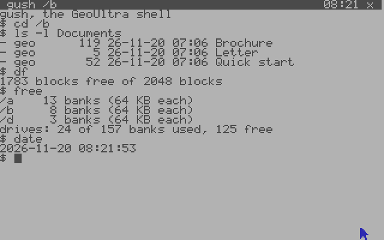

*A gush session.*

gush is GeoUltra's shell: a text console with commands for files and
folders on the GEOS drives and on the Ultimate, scripts with variables
and control flow, pipes, and network commands. Programs started from it
run as they would from the desktop.

## Starting and leaving

- From the desktop: geos > gush (C=G), or the toolbar's last button.
- From any application: geoFolder's gush button.
- At the start instead of the desktop: `start=gush` in the `[system]`
  section of `SETTINGS.INI`.
- `exit`, or a click on the "x" at the right of its status line,
  returns to the desktop.

At its start gush runs `GEOULTRA/gushrc` if it exists (a script: set
variables, `PATH`), and reads the history of earlier sessions from
`GEOULTRA/gush_history`.

## The screen and keys

53 columns by 24 rows of text, with a status line on top showing the
current folder, the time and a close button.

| Key | |
| --- | --- |
| RETURN | run the line |
| DEL | delete the character before the cursor |
| INST | delete the character under the cursor |
| cursor left / right | move along the line |
| cursor up / down | the history: older / newer lines (128 kept, the newest 100 saved) |
| HOME | the cursor to the line's start |
| CLR | clear the screen |
| `<-` | complete the name before the cursor |
| `↑` (the key left of RESTORE) | types `\|` |
| C= + `(` `)` `-` `'` `↑` | type `{` `}` `_` `` ` `` `~` |
| CTRL+A / CTRL+E | the line's start / end |
| CTRL+K / CTRL+U | cut the line after / before the cursor |
| CTRL+C, RUN/STOP | drop the line; stop `ls`, `more`, a copy |

A mouse click on the input line puts the cursor there.

**Completion:** `<-` completes the word before the cursor from the names
in its folder; a line's first word also from gush's commands. Pressing
`<-` again when nothing more can be added lists the names that fit.

## Paths

| Path | |
| --- | --- |
| `/a` ... `/d` | GEOS drives A-D (their folders and 1581 partitions) |
| `/e` | the system drive, read-only (`/e/bin`: external commands) |
| `/usb0`, `/usb1`, `/sd` | the Ultimate's file system |
| `/` | the list of the above |

Relative paths, `.` and `..` work as usual. A drive's name and a colon
switches drives as on DOS: `b:` goes back to the folder you were last in
on drive B. On GEOS drives names are exact and case-sensitive; on the
Ultimate case-insensitive. GEOS files copied onto the Ultimate become
`name.cvt` and come back as GEOS files; `-R` copies raw.

## Command lines

- **Words** are separated by spaces. `"..."` and `'...'` keep spaces;
  `\` takes the next character as it is.
- **Wildcards** `*` and `?` in a word's last part are replaced by the
  matching names.
- **Variables:** `NAME=value` sets one; `$NAME` or `${NAME}` uses it,
  also inside `"..."` but not inside `'...'`. `set` lists them, `unset
  NAME` removes one. `$?` is the last status: 0 when the line worked.
- `;` separates statements; `#` at a word's start begins a comment.
- **Redirection:** `> file` (new), `>> file` (appended), `< file`
  (input).
- **Pipes:** `a | b | c`, each command's output the next one's input
  (at most 32 KB per stage).

## Control flow and scripts

```
if test -f letter; then echo file; else echo none; fi
while read LINE; do echo "> $LINE"; done < list
for F in *.cvt; do cp $F /a; done
```

`elif` works as in sh. Blocks nest (16 open at most). Conditions are
commands: their status decides (0 is true). `test EXPR`
and `[ EXPR ]` take `-e`, `-f`, `-d path` (exists, file, folder), `-z`,
`-n word` (empty, not empty), `a = b`, `a != b`, numbers with `-eq -ne
-lt -le -gt -ge`, and `! EXPR`. `read NAME...` reads a line into
variables.

A plain text file whose name is typed runs as a script; so does `source
file [words]`. In a script `$0` is its path, `$1`-`$9` its words, `$#`
their number; `exit N` ends it with status N.

## Commands

| Command | |
| --- | --- |
| `ls [-l] [path...]` | list; `-l` with type, size, date and the short name |
| `cd [path]`, `pwd` | change / show the current folder |
| `cp [-frR] source... target` | copy; asks before overwriting unless `-f`; `-r` folders; `-R` raw (no CVT) |
| `mv [-fR] source... target` | move or rename |
| `rm [-f] path...` | delete (asks unless `-f`) |
| `mkdir [-t tracks] path...`, `rmdir path...` | folders (`-t`: a 1581 partition's size) |
| `cat [path...]`, `more [path...]` | show files; `more` a page at a time |
| `df [path]` | free and total space |
| `mount`, `mount image /drive`, `umount /drive` | the drives' images; mount or unmount one |
| `mkimg [-t tracks] type path [name]` | a new empty `d64`, `d71`, `d81` or `dnp` image |
| `free` | the REU's use |
| `turbo [-s] [step]` | the speed (0-15); `-s` saves it |
| `date [YYYY-MM-DD HH:MM[:SS]]` | show or set the clock |
| `ntp [server]` | set the clock from a time server |
| `reboot` | write the drives back and restart GeoUltra |
| `ifconfig` | the Ultimate's network address |
| `wget [-O name] http://host[:port]/path` | download a file over HTTP (no HTTPS) |
| `echo`, `clear`, `help [command]`, `exit [N]` | |
| `set`, `unset`, `source`, `test`, `[`, `read`, `true`, `false` | variables, scripts, conditions |

A word that is no command is looked for as a program: by its path, in
the current folder, the root of each drive A-D, and the folders in
`PATH` (`/e/bin:/USB0/GEOULTRA/bin`). A GEOS application is started (a
document after its name is passed to it: `geoWrite letter`); a desk
accessory runs and returns to gush; an external command (a GEOS file
of class `gush cmd`) runs inside gush; a text file runs as a script.
Your own external commands go into `GEOULTRA/bin`
(docs/reference/GUSH_COMMANDS.md explains how to write them).

# Files on the stick

GeoUltra's home folder `GEOULTRA` (on `/USB0`, `/USB1` or `/SD`, the
first found):

| File or folder | |
| ------- | ------------------------------- |
| `MOUNTS.INI` | the images mounted at the start (`[drives]`, `A=` ... `D=`) |
| `SETTINGS.INI` | the settings (below) |
| `RECENT.INI` | the recent documents |
| `HIBERNAT.BIN` | a hibernated session |
| `FONTS.DNP` | the system fonts |
| `THEMES/` | the themes |
| `BACKUP/` | a copy of each image before its first write after mounting |
| `print/` | PDF and PostScript files |
| `fonts/` | font CVTs to install (the top) and a library (subfolders) |
| `bin/` | your own gush commands |
| `gushrc`, `gush_history` | gush's start script and history |

The main keys of `SETTINGS.INI` (Settings writes them; you can edit
them on a PC while GeoUltra is not running):

```
[system]
start=gush           (gush instead of the desktop)
serial=12AB          (none: the boot disk's; 4755: GeoUltra's own)
protection=bypass    (the bypass; leave out for off)
diskfonts=hide       (programs' font lists: only the system fonts)
autoexec=/a/CONFIGURE (one line per auto-exec program, in order)
legacy=1024          (the REU older applications see per task, KB: 512-4096)
tasks=4              (task slots)
spool=512            (the print queue, KB)

[desktop]
theme=GeoUltra
view=list            (list, icons, detailed)
sort=name            (name, date, size; "-" in front: reversed)
clock=24             (24, 12, off)
toolbar=16           (16: two lines, 8: one line, off)
panes=1              (1: one list, 2: two panes)
printer=GU Epson FX-80

[print]
fastbus=on           (the GU Epson and MPS drivers send faster)
paper=letter         (GU PostScript; A4 without it)
pslook=c64           (GU PostScript; real text without it)

[serials]
geoWrite=58B5        (an application's own serial, by its class)

[favourites]
/usb0/geoultra
```

# Limits and known problems

- **Ultimate 64 family only** in this version. The Ultimate II+ (on a
  C64) and the C128 follow later.
- **No real disk drives** on the serial bus yet; GEOS drives are disk
  images.
- **Not every GEOS application runs.** See "What was tested".
  Applications that check for an original disk (copy protection on the
  disk itself) need the bypass, which is off by default.
- **geoPublish**: the copy tried showed a garbled screen, the same on
  genuine GEOS 2.0, so that copy is damaged; another copy is untested.
- Folders with more than 384 entries are shown in the order on disk; a
  folder holds at most 2048 entries in the list. The icon view keeps
  the first 376 entries' icons in the REU.
- `wget` speaks plain HTTP only (no HTTPS, no redirects).
- The REU holds about 10 MB of disk images for all mounted drives
  together.

# What was tested

On an **Ultimate 64-II** with firmware 3.15a and in **VICE 3.10** (with
a 16 MB REU):

- GEOS 2.0's deskTop, **geoWrite 2.1** and **geoPaint 2.0** run;
  geoWrite documents print through GeoUltra's drivers and GU
  PostScript.
- About 50 applications and desk accessories were started in VICE
  (geoCalc's and geoFile's companions, geoDex, geoMerge, geoSpell,
  geoLabel, geoFont, geoChart, geoMusic, geoLaser, Calculator, Note
  Pad and others); only starting was checked, not working with each.
- GeoUltra's own routines are compared with GEOS 2.0's behaviour by an
  automated test set (over 300 cases), on 1541 and 1581 disk images.

Reports of what works and what does not are welcome: see
`CONTRIBUTING.md` for what a bug report needs.
