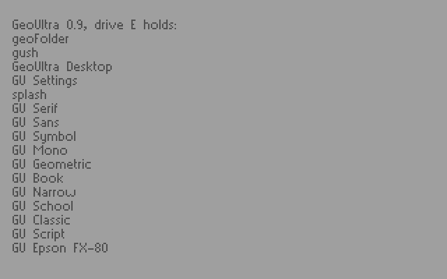

# GeoUltra developer guide

How to write a GEOS program that uses GeoUltra's additions, and how to
build and test it. What the additions are, address by address, is in
the [technical reference](TECHNICAL_REFERENCE.md); the GEOS 2.0
interface itself in [`GEOS_REFERENCE.md`](GEOS_REFERENCE.md) and
[`GEOS_API_REFERENCE.md`](GEOS_API_REFERENCE.md).

<!-- toc -->
<ul>
<li><a href="#write-for-geos-20-first">Write for GEOS 2.0 first</a>
</li>
<li><a href="#an-example-guinfo">An example: guinfo</a>
</li>
<li><a href="#building">Building</a>
</li>
<li><a href="#commands-for-gush">Commands for gush</a>
</li>
<li><a href="#testing">Testing</a>
</li>
<li><a href="#contributing">Contributing</a>
</li>
</ul>
<!-- /toc -->

## Write for GEOS 2.0 first

A program written for GEOS 2.0 through its jump table runs on GeoUltra
without changes, as far as GeoUltra matches GEOS 2.0 (the manual's
"What was tested" says what was checked). Use GeoUltra's additions only
after detecting GeoUltra, so the same program keeps running on GEOS 2.0
and its successors:

- **Detect** with the signature "GU" at `$C0E0`, then read the version
  at `$C0E2` (major, minor) if you need a newer function.
- **Do not** jump into the kernal outside the jump table, read its
  internal tables, program the REU's registers directly (use `DoRAMOp`
  and friends: your program gets eight banks of its own), or talk to
  disk drives over the serial bus: GeoUltra's drives are disk images in
  the REU.

## An example: guinfo

[`docs/examples/guinfo.s`](../examples/guinfo.s) is a complete GEOS
application in ca65 assembler. It clears the screen, checks for
GeoUltra, and lists the files of drive E through the file engine;
without GeoUltra it says so. A click returns to the desktop.



It was built as below and run on GeoUltra in VICE (the picture). The
parts worth copying:

```
IsGeoUltra:                     ; C set when GeoUltra runs
        clc
        lda $C0E0
        cmp #'G'
        bne @no
        lda $C0E1
        cmp #'U'
        bne @no
        sec
@no:    rts

FileEngine:                     ; A = function, as the function needs
        pha
        clc
        lda $C0E4               ; guExtTable
        adc #30                 ; the FileEngine entry
        sta vector
        lda $C0E5
        adc #0
        sta vector+1
        pla
        jmp (vector)            ; returns to our caller, X = 0 or an error
```

A folder is listed with `FE_OPENDIR` (r0 = a path; A = a handle), then
`FE_READDIR` until it returns X = `FE_END_OF_DIR` (`$48`), then
`FE_CLOSE`. Paths name GEOS drives as `/a`-`/e` and the Ultimate's file
system as `/usb0`, `/usb1`, `/sd`. The other functions, their registers
and errors are in the technical reference, "The file engine".

The folder functions (`GetCurDir`, `SetCurDir`, `DirUp`, `DirRoot`,
`MakeDir`, `RemoveDir`) are reached the same way, at their offsets in
the extension table (+0 to +25).

## Building

GeoUltra's own programs are built with **ca65/ld65** (cc65's assembler
and linker) and packed into GEOS files with GeoUltra's
`tools/dev/geosapp.py`, which writes a CVT file from the binary and a
TOML description of the file header (name, type, class, version,
author, info text, icon). For the example:

    ca65 -o guinfo.o docs/examples/guinfo.s
    ld65 -C docs/examples/guinfo.cfg -o guinfo.bin guinfo.o
    python3 tools/dev/geosapp.py docs/examples/guinfo.toml guinfo.bin guinfo.cvt

[`guinfo.cfg`](../examples/guinfo.cfg) links the program at `$0400`,
where GEOS loads applications; [`guinfo.toml`](../examples/guinfo.toml)
describes its header. `geosapp.py` documents all its keys at its top
(desk accessories, icons, GEOS 128 modes, the start address).

Put the CVT on a disk image with GeoUltra's `geosdisk` (see the tools
manual), or copy it to the Ultimate's storage and copy it onto a GEOS
drive from the desktop or with gush's `cp`, which converts CVT files:

    python3 tools/geosdisk.py add mydisk.d64 guinfo.cvt

A C library for GEOS programs with Oscar64 (geos-oscar64), which GeoUltra
uses for some of its tests, is to be published separately.

## Commands for gush

gush, GeoUltra's shell, runs external commands: small programs that gush
loads when their name is typed (found along `PATH`, by default
`/e/bin:/USB0/GEOULTRA/bin`), runs with the line's words in a 4 KB area
of its own memory, and forgets again. They use routines gush offers. How to write one is in
[`GUSH_COMMANDS.md`](GUSH_COMMANDS.md).

## Testing

- **In VICE** (3.10 or later, `x64sc`): GeoUltra's cartridge
  (`build/geoultra64.crt`, or `geoultra64.crt` from a release) with a
  16 MB REU: `x64sc -cartcrt geoultra64.crt -reu -reusize 16384`. VICE
  has no Ultimate, so everything that needs the Ultimate's file system,
  network or clock is missing there; GEOS drives, the kernal and drive E
  work. `make vice` does this from the source tree.
- **On an Ultimate 64**: put the CVT on the stick (FTP, or the
  Ultimate's own file browser), copy it onto a GEOS drive from the
  desktop or with gush's `cp` (both convert it back to a GEOS file), and
  start it there.
- GeoUltra's own test harness (`tools/dev/harness/`) drives VICE through
  its binary monitor: `tools/dev/harness/apprun.py NAME` starts a program
  from an applications disk and saves the screen; ARCHITECTURE.md,
  "Conformance harness", explains it.

## Contributing

Changes to GeoUltra itself: see [`CONTRIBUTING.md`](../../CONTRIBUTING.md).
